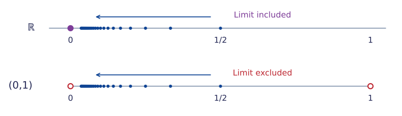
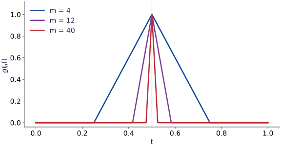
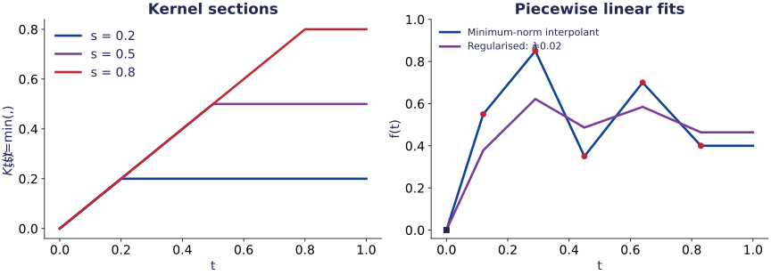
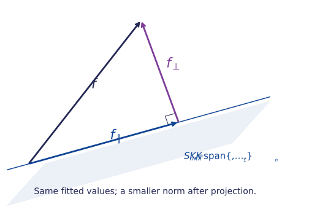
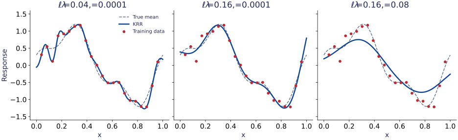
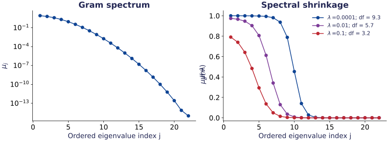
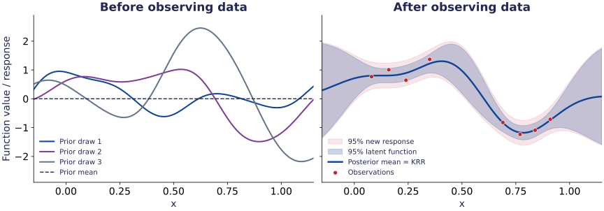

$\newcommand{\R}{\mathbb{R}}$
$\newcommand{\X}{\mathcal{X}}$
$\newcommand{\H}{\mathcal{H}}$
$\newcommand{\ip}[2]{\langle #1,#2\rangle_{\H}}$
$\newcommand{\hnorm}[1]{\lVert #1\rVert_{\H}}$
$\newcommand{\E}{\mathbb{E}}$

<!-- Four sessions of 70 minutes, including discussion and exercises.
1: kernels and features 40; vector spaces, inner products and norms 30
   (the beginning of Section 2), including selected exercise parts.
2: metrics, convergence and completeness 30; Hilbert spaces and RKHS 20;
   Sobolev example 20. Use selected exercise parts in class; leave the full
   construction argument and Sobolev interpolation for independent work.
3: representer theorem 20; KRR and singular matrices 20; computation/demo 15;
   exercises/model selection 15. Intercept details are in the optional appendix.
4: matrix spectrum/bias-variance 20; Mercer and population regularisation 20;
   Gaussian process regression 30. Use selected exercise parts in class;
   low-rank approximation and its exercise are independent reading.
   Derivation of Sobolev eigenfunctions and population existence are in
   speaker notes; random features are optional.
The Machine Learning notes (classes 20--23, local scanned PDFs) were inspected.
The min(s,t) example is revisited to add absolute continuity, completeness,
the variational interpretation, and its spectral description.
All Python is run separately; the interactive example uses browser JavaScript.
-->

# 1. Kernels and feature geometry {section-time="40"}

## From learned features to fixed feature spaces

Recall the neural-network score $s_\theta(x)=c+v^\top h_\vartheta(x)$.

| Approach | Representation | What is fitted? |
|:--|:--|:--|
| Linear regression | $x\in\R^d$ | Linear coefficients |
| Feature regression | A chosen $\phi(x)\in\R^m$ | Linear coefficients |
| Neural networks | $h_\vartheta(x)$ | Representation and coefficients |
| Kernel methods | A chosen feature geometry | A function in the associated space |

- A kernel can encode an [infinite-dimensional representation]{.purple}.
- We choose its geometry and hyperparameters; training fits the predictor.
- **Aim:** understand what the kernel assumes about functions, and how regularisation uses those assumptions.

## Feature regression only needs certain inner products

For a fixed map $\phi:\X\to\R^m$, let $\Phi_{ij}=\phi_j(x_i)$.

::: {.eqbox title="Feature ridge regression"}
$$\widehat w=\arg\min_{w\in\R^m}
\left\{\frac1n\|y-\Phi w\|_2^2+\lambda\|w\|_2^2\right\},
\qquad \lambda>0.$$
:::

The normal equations give $(\Phi^\top\Phi+n\lambda I_m)\widehat w=\Phi^\top y$.

::: {#prp-kernel-primal-dual name="Primal and dual forms"}
$$\widehat w=\Phi^\top\alpha,\qquad
(\Phi\Phi^\top+n\lambda I_n)\alpha=y.$$
:::

Prediction uses only $K(x,z)=\phi(x)^\top\phi(z)$.

::: {.notes}
Verify the statement by multiplying Phi^T alpha by the primal normal-equation
matrix. Both regularised matrices are positive definite. With row vectors
phi(x_i)^T in Phi, Phi Phi^T is n by n, whereas Phi^T Phi is m by m.
No intercept is included here; it is treated separately in the appendix.
:::

## What is a kernel?

::: {#def-kernel name="Positive semidefinite kernel"}
A function $K:\X\times\X\to\R$ is a kernel if it is **symmetric** and

$$\sum_{i,j=1}^n a_i a_jK(x_i,x_j)\geq0$$

for every $n\geq1$, every $x_1,\ldots,x_n\in\X$ and every $a\in\R^n$.
:::

- The **Gram matrix** is $G=(K(x_i,x_j))_{i,j=1}^n$; the condition is $G\succeq0$.
- Many books call this a *positive definite kernel*, allowing equality.
- [Strict positive definiteness]{.purple} requires $a^\top Ga>0$ for $a\ne0$ and **distinct** inputs.
- A kernel may take negative values. Its Gram matrices must satisfy a quadratic inequality.

## A similarity score need not be a kernel

On $\X=\{a,b\}$, consider

$$K(a,a)=K(b,b)=1,\qquad K(a,b)=K(b,a)=2.$$

::: {.eqbox colour="red"}
$$G=\begin{pmatrix}1&2\\2&1\end{pmatrix},\qquad
\begin{pmatrix}1&-1\end{pmatrix}G
\begin{pmatrix}1\\-1\end{pmatrix}=-2<0.$$
:::

- Symmetry, nonnegative entries and a positive diagonal are **insufficient**.
- A valid kernel necessarily satisfies $|K(x,z)|^2\leq K(x,x)K(z,z)$.
- Checking a few Gram matrices can [disprove]{.red} validity; it does not establish validity on an entire domain.

::: {.notes}
The inequality follows from the determinant of the 2 by 2 positive
semidefinite Gram matrix. Later it also follows from Cauchy--Schwarz in the RKHS.
:::

## Examples and the assumptions they encode

| Kernel | Domain and parameters | Interpretation |
|:--|:--|:--|
| $K(x,z)=x^\top z$ | $\R^d$ | Linear features |
| $K(x,z)=(c+x^\top z)^p$ | $c\geq0$, integer $p\geq1$ | Polynomial interactions |
| $K_\ell(x,z)=\exp\{-\|x-z\|_2^2/(2\ell^2)\}$ | $\R^d$, $\ell>0$ | Gaussian radial basis function (RBF) |
| $K(s,t)=\min(s,t)$ | $[0,1]$ | Anchored functions with square-integrable derivative |

- $\ell$ sets the [scale of comparison]{.blue} in the input space.
- A kernel specifies both a function space and a norm on that space.
- The last example will make this norm explicit.

## Constructing kernels

::: {#prp-kernel-algebra name="Kernel algebra"}
If $K_1,K_2$ are kernels, $a\geq0$, $h:\X\to\R$, and $T:\mathcal Z\to\X$, each of the following defines a kernel:

1. **Sum:** $K=K_1+K_2$.
2. **Nonnegative scaling:** $K=aK_1$.
3. **Product:** $K(x,y)=K_1(x,y)K_2(x,y)$.
4. **Multiplication by a function:** $K(x,y)=h(x)K_1(x,y)h(y)$.
5. **Composition:** $K(u,v)=K_1(T(u),T(v))$ on $\mathcal Z$.
6. **Pointwise limit:** $K(x,y)=\lim_{m\to\infty}K_m(x,y)$, provided each $K_m$ is a kernel and the limit exists and is finite for every $x,y\in\X$.
:::

**Why?** Gram matrices use sums, entrywise products, or $DGD$; alternatively, construct feature maps.

::: {.notes}
For the product, cite the Schur product theorem or use tensor-product features.
For finite-dimensional features, coordinates are phi_j(x) psi_k(x).
For a pointwise limit, every finite quadratic form is a limit of nonnegative
numbers. Here 'finite' means the limiting values are real, not infinity.
The coefficients in a positive combination must be nonnegative; h itself need not be.
:::

## Exercise: prove the kernel algebra

::: {#exr-kernel-algebra name="Closure properties of kernels" block-style="6"}
Prove all six properties in @prp-kernel-algebra using the definition of a kernel.

- For the product, factor the two Gram matrices as $G_1=BB^\top$ and $G_2=CC^\top$, and construct vectors whose inner products give $K_1(x_i,x_j)K_2(x_i,x_j)$.
- For the pointwise limit, justify passing the limit through a finite quadratic form.
:::

::: {.notes}
Allow about 5 minutes for selected properties; leave the others for independent
work. Symmetry holds in all six cases. Sum and scaling preserve nonnegative
quadratic forms. For the product, let v_i have coordinates B_{ip}C_{iq};
then v_i^T v_j=(G_1)_{ij}(G_2)_{ij}, so the new Gram matrix is positive
semidefinite. Multiplication by h gives D G_1 D with D_{ii}=h(x_i).
Composition uses the Gram matrix at the transformed inputs T(u_i).
For a pointwise limit, fix arbitrary n, inputs and coefficients: the finite
sum converges to the limiting quadratic form, which is nonnegative because
every quadratic form in the sequence is nonnegative.
:::

## Exercise: validity of the Gaussian kernel

::: {#exr-kernel-gaussian name="The Gaussian kernel" block-style="6"}
Let $\ell>0$. Prove that

$$K_\ell(x,z)=\exp\left\{-\frac{\|x-z\|_2^2}{2\ell^2}\right\},
\qquad x,z\in\R^d,$$

is a kernel, using the closure properties in @prp-kernel-algebra.

**Hint:** expand $\|x-z\|_2^2$ and use the power series of the exponential.
:::

::: {.notes}
For each M, the partial sum
$$\sum_{r=0}^{M}\frac{(x^\top z)^r}{r!\ell^{2r}}$$
is a kernel by the sum, scaling and product properties, starting from the
linear kernel and the constant kernel 1. Its finite pointwise limit is
$e^{x^\top z/\ell^2}$. Finally, write
$$K_\ell(x,z)=e^{-\|x\|^2/(2\ell^2)}
e^{x^\top z/\ell^2}e^{-\|z\|^2/(2\ell^2)}$$
and apply multiplication by a function with $h(x)=e^{-\|x\|^2/(2\ell^2)}$.
This avoids constructing an infinite feature vector explicitly.
:::

## An explicit feature map

For $x,z\in\R$,

::: {.eqbox colour="purple"}
$$K(x,z)=(1+xz)^2
=\langle\phi(x),\phi(z)\rangle_{\R^3},\qquad
\phi(x)=(1,\sqrt2 x,x^2)^\top.$$
:::

Here the inner product on the right is the usual one on $\R^3$.

- A linear score in these features is a polynomial $f(x)=a+bx+cx^2$.
- Its feature-space squared norm is $a^2+b^2/2+c^2$.
- The factor $\sqrt2$ changes the [relative penalty on coefficients]{.purple}.

::: {.box title="Function values do not determine regularisation by themselves"}
The same set of polynomials can carry different norms. The kernel records that choice of geometry.
:::

::: {.notes}
The feature vectors span R^3 on the domain R, so their coefficient
representation is unique.
:::

# 2. RKHS: evaluation and smoothness {section-time="100"}

## Why use a space of functions?

We wish to optimise

$$\text{data fit}(f)+\lambda\,\text{complexity}(f).$$

- **Linear structure:** add predictors and multiply them by scalars.
- **Geometry:** use an inner product and the norm it induces.
- **Limits:** sequences of improving approximations should have a limit in the space.
- **Stable evaluation:** a small change in norm gives a small change in $f(x_i)$.

::: {.box title="Two different continuity questions"}
Continuity of $x\mapsto f(x)$ concerns the input.
Continuity of $f\mapsto f(x)$ concerns the function-space norm.
:::

## First: what is a vector space?

::: {#def-kernel-vector-space name="Real vector space"}
A **real vector space** is a nonempty set $V$ with addition $u+v\in V$ and scalar multiplication $au\in V$, for $u,v\in V$ and $a\in\R$, satisfying:

1. **Addition:** $u+v=v+u$ and $(u+v)+w=u+(v+w)$.
2. **Zero and inverses:** there is $0\in V$ with $u+0=u$; each $u$ has $-u$ with $u+(-u)=0$.
3. **Scalar multiplication:** $1u=u$ and $a(bu)=(ab)u$.
4. **Distributivity:** $a(u+v)=au+av$ and $(a+b)u=au+bu$.
:::

The elements need not be coordinate vectors: [functions can be vectors]{.purple}.

## Functions as vectors

Let $V=C[0,1]$, the set of continuous real-valued functions on $[0,1]$.

::: {.eqbox title="Pointwise operations"}
$$(f+g)(t)=f(t)+g(t),\qquad (af)(t)=af(t).$$
:::

- These operations preserve continuity, so their outputs remain in $V$.
- The zero vector is the function $t\mapsto0$; the additive inverse is $-f$.
- The vector-space identities hold because they hold at each $t$ in $\R$.
- The set $\mathcal P_m$ of polynomials of degree at most $m$ is another example.

::: {.box title="Subspace"}
A nonempty subset $S\subseteq V$ is a **linear subspace** if $af+bg\in S$ for all $f,g\in S$ and $a,b\in\R$.
:::

## Exercise: linear constraints on functions

::: {#exr-kernel-vector-spaces name="Which sets are vector spaces?" block-style="6"}
For each subset of $C[0,1]$ below, determine whether it is a linear subspace. Prove closure when it holds; otherwise give a counterexample.

1. $S_0=\{f:f(0)=0\}$.
2. $S_1=\{f:f(0)=1\}$.
3. $S_2=\{f:\int_0^1 f(t)\,dt=0\}$.
4. The set of polynomials of degree **exactly** two.

Which of these sets could serve as a vector space of predictors without changing its defining constraint?
:::

::: {.notes}
Allow about 5 minutes for selected parts. S0 and S2 are subspaces by
linearity of evaluation and integration. S1 does not contain zero, and
adding two members gives value two at zero. Exact degree two excludes zero;
adding t^2 and -t^2 also disproves closure. Contrast with degree at most two.
The constraints f(0)=0 and integral f=0 are homogeneous; f(0)=1 is affine.
:::

## An inner product adds geometry

::: {#def-kernel-inner-product name="Real inner product"}
An **inner product** on a real vector space $V$ is a map $\langle\cdot,\cdot\rangle:V\times V\to\R$ such that

1. $\langle au+bv,w\rangle=a\langle u,w\rangle+b\langle v,w\rangle$.
2. $\langle u,v\rangle=\langle v,u\rangle$.
3. $\langle u,u\rangle\geq0$, with equality if and only if $u=0$.
:::

Examples:

- On $\R^d$: $\langle u,v\rangle=\sum_{j=1}^d u_jv_j$.
- On $C[0,1]$: $\langle f,g\rangle=\int_0^1 f(t)g(t)\,dt$.

The last condition distinguishes an [inner product]{.blue} from a merely positive semidefinite form.

::: {.notes}
Symmetry and linearity in the first argument imply linearity in the second.
For continuous f, integral f^2=0 forces f=0 everywhere: any nonzero value
would, by continuity, give a neighbourhood with a strictly positive integral.
For arbitrary measurable functions this argument fails at individual points;
we return to equality almost everywhere when discussing L2.
:::

## From an inner product to a norm

::: {#def-kernel-induced-norm name="Induced norm"}
The norm induced by an inner product is
$$\|u\|=\sqrt{\langle u,u\rangle}.$$
:::

It satisfies the three norm properties:

1. $\|u\|\geq0$, and $\|u\|=0$ if and only if $u=0$.
2. $\|au\|=|a|\,\|u\|$.
3. $\|u+v\|\leq\|u\|+\|v\|$ (**triangle inequality**).

::: {.eqbox title="Cauchy–Schwarz inequality" colour="purple"}
$$|\langle u,v\rangle|\leq\|u\|\,\|v\|.$$
:::

For the integral inner product, $\|f\|_2=(\int_0^1|f(t)|^2\,dt)^{1/2}$.

::: {.notes}
For v nonzero, expand ||u-tv||^2>=0 and minimise over the real scalar t
to obtain Cauchy--Schwarz. Then expand ||u+v||^2 and apply this inequality
to obtain the triangle inequality. This establishes the norm properties;
do not assume them solely from positive definiteness.
:::

## Exercise: does a derivative define an inner product?

::: {#exr-kernel-derivative-inner-product name="The role of a boundary condition" block-style="5"}
On $C^1[0,1]$, consider
$$B(f,g)=\int_0^1 f'(t)g'(t)\,dt.$$

1. Verify symmetry and bilinearity. Is $B$ an inner product on $C^1[0,1]$?
2. Show that $B$ is an inner product on $V_0=\{f\in C^1[0,1]:f(0)=0\}$.
3. Prove that $\widetilde B(f,g)=f(0)g(0)+B(f,g)$ is an inner product on all of $C^1[0,1]$.
:::

::: {.notes}
Allow about 5 minutes for parts 1--2; part 3 can be independent work.
Nonzero constant functions have B(f,f)=0, so positive definiteness fails
on C1. If integral (f')^2=0, continuity gives f'=0, so f is constant;
the anchored condition forces that constant to be zero. In the third part,
both nonnegative terms must vanish, again forcing f=0. These statements
establish inner products, not completeness. The anchored C1 space will
later be enlarged to absolutely continuous functions with L2 derivatives.
:::

<!-- Suggested start of session 2: the preceding foundations finish session 1. -->

## A metric measures distance

::: {#def-kernel-metric name="Metric space"}
A **metric space** is a nonempty set $M$ equipped with a map $d:M\times M\to[0,\infty)$ satisfying, for all $u,v,w\in M$:

1. $d(u,v)=0$ if and only if $u=v$.
2. $d(u,v)=d(v,u)$.
3. $d(u,w)\leq d(u,v)+d(v,w)$.
:::

Every norm gives a metric:

::: {.eqbox}
$$d(u,v)=\|u-v\|.$$
:::

A general metric space need not have addition, scalar multiplication or an inner product.

## Convergence in a metric space

::: {#def-kernel-metric-convergence name="Convergence"}
A sequence $(u_m)$ in $(M,d)$ **converges to $u\in M$** if
$$\forall\varepsilon>0\quad\exists N\quad\forall m\geq N:
\qquad d(u_m,u)<\varepsilon.$$
:::

- We write $u_m\to u$ or $d(u_m,u)\to0$.
- The limit must belong to the specified space $M$.
- With an induced metric, convergence means $\|u_m-u\|\to0$.
- Convergence depends on the metric; for functions, it need not mean convergence at every input.

For example, $d_2(f,g)=(\int_0^1|f-g|^2)^{1/2}$ measures an integrated discrepancy, while $d_\infty(f,g)=\sup_{t\in[0,1]}|f(t)-g(t)|$ measures the largest discrepancy on $C[0,1]$.

## Cauchy sequences: compare terms with one another

::: {#def-kernel-cauchy name="Cauchy sequence"}
A sequence $(u_m)$ in $(M,d)$ is **Cauchy** if
$$\forall\varepsilon>0\quad\exists N\quad\forall m,k\geq N:
\qquad d(u_m,u_k)<\varepsilon.$$
:::

- All sufficiently late terms must be close to **one another**.
- This definition does not require a candidate limit.
- Every convergent sequence is Cauchy, by the triangle inequality.
- Requiring only $d(u_{m+1},u_m)\to0$ is [insufficient]{.red}.

::: {.eqbox title="Compare the two conditions"}
$$\text{Convergent: }d(u_m,u)\to0.
\qquad
\text{Cauchy: }\sup_{m,k\geq N}d(u_m,u_k)\to0\quad(N\to\infty).$$
:::

## Exercise: small steps do not suffice

::: {#exr-kernel-cauchy name="Convergence and the Cauchy condition" block-style="6"}
1. Prove that every convergent sequence in a metric space is Cauchy. Indicate where the triangle inequality is used.
2. In $\R$ with $d(x,y)=|x-y|$, let $s_m=\sum_{j=1}^m1/j$. Show that $|s_{m+1}-s_m|\to0$.
3. Prove that $s_{2m}-s_m\geq1/2$, and deduce directly from the definition that $(s_m)$ is not Cauchy.
:::

::: {.notes}
About 5 minutes. For part 1 take N such that d(u_m,u)<epsilon/2 for
all m>=N, and bound d(u_m,u_k) by the sum of distances to u.
For the harmonic partial sums each of the m summands from m+1 to 2m
is at least 1/(2m). Taking epsilon=1/2 in the strict Cauchy inequality
disproves the condition for every N. A proof that the harmonic series
diverges is not needed; the exercise checks the quantifiers themselves.
:::

## Completeness is a property of the metric space

::: {#def-kernel-complete-metric name="Complete metric space" block-style="6"}
A metric space $(M,d)$ is **complete** if every Cauchy sequence in $M$ converges to an element of $M$.
:::

- Completeness concerns **every** Cauchy sequence, not just a chosen example.
- A Cauchy sequence may approach a point excluded from the space.
- Both the set and the metric are part of the statement.

::: {.box title="A familiar complete space"}
$\R$ with $d(x,y)=|x-y|$ is complete. More generally, $\R^d$ with Euclidean distance is complete.
:::

## A Cauchy sequence can have a missing limit

In $M=(0,1)$ with the usual distance, let $u_m=1/(m+1)$, $m\geq1$.

::: {.eqbox colour="purple"}
$$|u_m-u_k|\leq\frac1{N+1}\quad(m,k\geq N),
\qquad u_m\longrightarrow0\text{ in }\R.$$
:::

{height=260px fig-alt="Two number lines show the sequence one over m plus one tending to zero. Zero is included on the real line and excluded from the interval (0,1)."}

Since $0\notin(0,1)$, this space is [not complete]{.red}. The sequence has no alternative limit inside $(0,1)$, since metric limits are unique.

## Exercise: completeness of a function space

::: {#exr-kernel-polynomial-completeness name="A limit outside the polynomial space" block-style="5"}
Let $\mathcal P$ contain all real polynomials on $[0,1]$, with $d_2(p,q)=(\int_0^1|p-q|^2)^{1/2}$. Set $p_m(t)=\sum_{j=0}^m(t/2)^j$.

1. Show that, for $k>m$, $\sup_{t\in[0,1]}|p_k(t)-p_m(t)|\leq2^{-m}$. Deduce that $(p_m)$ is Cauchy for $d_2$.
2. Show that $p_m$ converges uniformly to $f(t)=(1-t/2)^{-1}$ and that $f$ is not a polynomial.
3. Explain why no polynomial can be its $d_2$ limit. Conclude that $(\mathcal P,d_2)$ is not complete.
:::

::: {.notes}
About 6 minutes for selected parts; finish independently if necessary.
Bound the geometric tail by sum_{j=m+1}^infinity 2^{-j}=2^{-m}.
The integral norm is at most the uniform norm because the interval has
length one. The same bound gives uniform and d2 convergence to f.
If a polynomial p equalled f throughout [0,1], the polynomial
(1-t/2)p(t)-1 would vanish on an interval and hence identically, which
is impossible at t=2. If p_m converged to a polynomial p in d2, the
triangle inequality would give d2(p,f)=0. The continuous function p-f
would then be zero everywhere, giving the contradiction above.
This is an inner-product space that lacks completeness, despite allowing
polynomials of arbitrarily high degree.
:::

## Now: a Hilbert space

::: {#def-kernel-hilbert name="Hilbert space"}
A **Hilbert space** is a vector space $\H$ with an inner product such that the induced metric
$$d(f,g)=\hnorm{f-g}=\sqrt{\ip{f-g}{f-g}}$$
makes $\H$ a complete metric space.
:::

- Equivalently, every norm-Cauchy sequence has a norm limit **in $\H$**.
- $\R^d$ with its usual inner product is a Hilbert space.
- The polynomial space in @exr-kernel-polynomial-completeness has an inner product but is **not** a Hilbert space.

::: {.eqbox title="The three ingredients" colour="purple"}
$$\text{Hilbert space}
=\text{vector space}+\text{inner product}+\text{completeness}.$$
:::

## Example: $L^2[0,1]$

::: {#exm-kernel-l2 name="Square-integrable functions" block-style="6"}
Informally, $L^2[0,1]$ consists of real-valued functions on $[0,1]$ for which
$$\int_0^1|f(t)|^2\,dt<\infty.$$

Its inner product and norm are
$$\langle f,g\rangle_{L^2}=\int_0^1 f(t)g(t)\,dt,
\qquad
\|f\|_{L^2}=\left(\int_0^1|f(t)|^2\,dt\right)^{1/2}.$$

This space is **complete** for the induced metric, so [it is a Hilbert space]{.purple}.
:::

- Every continuous function on $[0,1]$ belongs to $L^2[0,1]$.
- Discontinuous functions can also belong: for example, $f(t)=\mathbf1_{[1/2,1]}(t)$.
- A Cauchy sequence in this norm has an $L^2$ limit, which need not be continuous.

::: {.notes}
Keep this introduction informal, as requested; leave the measure-theoretic
details to oral explanation. Strictly, functions are measurable and are
identified when they agree almost everywhere, so the integral form is
positive definite on the resulting space. Do not introduce equivalence
classes on the student slide. State completeness without proving it.
The polynomial example illustrates why restricting to a smaller function
space may lose completeness, even with the same integral norm.
:::

## The Hilbert-space toolkit

We will use two consequences of completeness:

1. **Orthogonal projection:** for a closed linear subspace $S$, each $f\in\H$ has a unique decomposition $f=f_S+f_\perp$, with $f_S\in S$ and $f_\perp\perp S$.
2. **Riesz representation:** every bounded linear functional $L:\H\to\R$ has a unique representer $h_L\in\H$ such that $L(f)=\ip f{h_L}$.

A subspace is **closed** if it contains the limits of its convergent sequences. Finite-dimensional subspaces are always closed.

::: {.notes}
These are stated as tools, not presumed prerequisites. A linear functional
is a linear map from H to R; boundedness means |L(f)|<=C||f|| for a fixed
finite C and every f. This is equivalent to continuity for a linear map.
Projection comes from minimising distance to S; the parallelogram identity
makes a minimising sequence Cauchy. Riesz can be motivated by projecting
onto the orthogonal complement of ker L. No general functional-analysis proof
is needed in this course. A pre-Hilbert space alone does not provide these tools.
:::

## An integral norm does not control a point value

:::: {.columns}
::: {.column width="48%"}
On continuous functions on $[0,1]$, use $\|f\|_{L^2}^2=\int_0^1 f(t)^2\,dt$.

Set $g_m(t)=\max\{1-m|t-1/2|,0\}$, $m\geq2$.

::: {.eqbox colour="red"}
$$g_m(1/2)=1,\qquad
\|g_m\|_{L^2}^2=\frac{2}{3m}\longrightarrow0.$$
:::

Thus evaluation at $1/2$ is **not continuous** for this norm.
:::
::: {.column width="52%"}
{width=100% fig-alt="Triangular spikes centred at one half with widths shrinking as m equals 4, 12 and 40. All peaks have height one."}
:::
::::

An integral norm can make two functions close while their values at a chosen input remain far apart. An RKHS will require [stable pointwise evaluation]{.blue}.

::: {.notes}
Separate the two issues: continuous functions with the integral norm give
well-defined but unbounded evaluations; completing to L2 gives equivalence
classes for which changing one value changes no element of L2.
Do not claim C[0,1] with this norm is Hilbert.
:::

## Stable evaluation defines an RKHS

::: {#def-kernel-rkhs name="Reproducing kernel Hilbert space"}
A Hilbert space $\H$ of **pointwise defined functions** $f:\X\to\R$ is an RKHS if, for every $x\in\X$, the evaluation functional

$$E_x:\H\to\R,\qquad E_x(f)=f(x)$$

is bounded: there exists $C_x<\infty$ such that $|f(x)|\leq C_x\hnorm f$ for all $f\in\H$.
:::

- $C_x$ may depend on $x$.
- Boundedness is equivalent to continuity because $E_x$ is linear.
- Norm convergence then implies [pointwise convergence]{.blue}.

## Riesz produces the reproducing kernel

Apply Riesz to each $E_x$. There is a unique $K_x\in\H$ such that

::: {.eqbox title="Reproducing property" colour="purple"}
$$f(x)=\ip f{K_x},\qquad f\in\H.$$
:::

Define $K(x,z)=\ip{K_x}{K_z}$; then $K_x(t)=K(t,x)$.

::: {#prp-kernel-evaluation-bound name="Norm of evaluation"}
$$\|E_x\|=\hnorm{K_x}=\sqrt{K(x,x)},\qquad
|f(x)|\leq\hnorm f\sqrt{K(x,x)}.$$
:::

**Why is $K$ a kernel?** $\sum_{i,j}a_ia_jK(x_i,x_j)=\hnorm{\sum_i a_iK_{x_i}}^2\geq0$.

::: {.notes}
Cauchy--Schwarz gives the bound. For K_x nonzero equality is attained by
f=K_x/||K_x||; when K_x=0 both operator and representer have norm zero.
The notation K_x denotes a function of t, not a scalar.
:::

## Conversely: a kernel determines an RKHS

::: {#thm-kernel-moore-aronszajn name="Moore–Aronszajn" block-style="6"}
For every symmetric positive semidefinite kernel $K$, there is a unique RKHS of functions on $\X$ with reproducing kernel $K$.

Its finite linear combinations of kernel sections are dense:
$$\H_K=\overline{\operatorname{span}\{K_x:x\in\X\}}.$$
:::

- **Canonical features:** $\phi(x)=K_x\in\H_K$.
- **Kernel trick:** $K(x,z)=\ip{\phi(x)}{\phi(z)}$.
- The full RKHS can be infinite-dimensional; a training set supplies only finitely many sections.

::: {.notes}
Uniqueness is as a function space with its inner product, not just up to an
unspecified dimension. Different feature realisations can contain unused
orthogonal directions; the canonical RKHS is the closed span of its sections.
Do not confuse the full space with the span at the observed training inputs.
:::

## Where completeness enters the construction

Start with $f=\sum_i a_iK_{x_i}$ and $g=\sum_j b_jK_{z_j}$. Set

::: {.eqbox}
$$\ip f g=\sum_{i,j}a_ib_jK(x_i,z_j).$$
:::

1. Positive semidefiniteness gives a nonnegative squared norm.
2. The reproducing identity and Cauchy–Schwarz give $|f(x)|\leq\hnorm f\sqrt{K(x,x)}$.
3. A zero-norm combination is zero at **every** $x$; different representations define the same inner product.
4. Complete this space. The bound makes each point value converge along Cauchy sequences.

The completion is therefore still a space of [actual functions]{.blue}.

::: {.notes}
One can begin with formal finite sums and quotient the null space. The
semidefinite bilinear form satisfies Cauchy--Schwarz by the quadratic
discriminant argument. A formal sum represents the zero function iff it has
zero norm: the reverse implication uses ||f||^2=sum_i a_i f(x_i).
In the completion, an element zero at every x is orthogonal to the dense span
of all sections and hence is zero. This establishes that no additional
nonzero completion elements have all evaluations zero. Uniqueness follows
by the isometry on finite sums and density in any RKHS with this kernel.
:::

## The familiar kernel $\min(s,t)$: specify the space carefully

::: {#def-kernel-sobolev name="An anchored Sobolev space"}
Let
$$\H=\left\{f:[0,1]\to\R:
f(t)=\int_0^t u(r)\,dr\ \text{for some }u\in L^2[0,1]\right\},$$
with $\ip f g=\int_0^1 f'(r)g'(r)\,dr$.
:::

- Every $f$ is **absolutely continuous**, $f(0)=0$, and $f'=u$ almost everywhere.
- Conversely, these three properties characterise this space.
- $\hnorm f^2=\int_0^1|f'(r)|^2\,dr$ penalises variation.
- The boundary condition is essential: [constants would otherwise have zero norm]{.red}.

::: {.notes}
Explain absolute continuity through the integral representation rather than
presuming a strong command of measure theory. A derivative exists almost
everywhere and recovers f by integration. Merely requiring continuous f with
an a.e. square-integrable derivative is insufficient: singular functions
can have derivative zero a.e. without being constant. We deliberately avoid
writing the more customary H_0^1 because it often imposes both endpoints.
:::

## This space really is complete

The map

$$D:\H\to L^2[0,1],\qquad Df=f'$$

is a **linear isometric bijection**, with inverse $u\mapsto\int_0^{\cdot}u(r)\,dr$.

::: {.proofbox title="Transfer completeness from L²"}
If $(f_m)$ is Cauchy in $\H$, then $(f_m')$ is Cauchy in $L^2$.
Let $f_m'\to u$ in $L^2$, and define $f(t)=\int_0^t u(r)\,dr$.
Then $f\in\H$ and

$$\hnorm{f_m-f}=\|f_m'-u\|_{L^2}\longrightarrow0.$$
:::

Also, by Cauchy–Schwarz,

::: {.eqbox}
$$|f(t)-f(s)|\leq\hnorm f\sqrt{|t-s|}.$$
:::

Thus evaluation is bounded, and norm convergence implies **uniform** convergence here.

## Compute its reproducing kernel

For $s\in[0,1]$, let $K_s(t)=\min(s,t)$. Then $K_s\in\H$ and
$K_s'(r)=\mathbf1_{(0,s)}(r)$ almost everywhere.

::: {.eqbox colour="purple"}
$$\ip f{K_s}=\int_0^s f'(r)\,dr=f(s),\qquad
K(s,t)=\min(s,t).$$
:::

{height=400px fig-alt="Kernel sections increase linearly until their centres and are then constant. Their fitted linear combinations are continuous piecewise linear functions through or near the observations, starting at zero."}

## Exercise: what the norm can see

::: {#exr-kernel-evaluation name="Evaluation and norm convergence" block-style="5"}
Use the spikes $g_m(t)=\max\{1-m|t-1/2|,0\}$, with $m\geq2$.

1. Verify $\|g_m\|_{L^2}^2=2/(3m)$ and compute $\hnorm{g_m}^2$ in the anchored Sobolev space.
2. Explain why this sequence disproves continuity of evaluation for the $L^2$ norm, but does not contradict its continuity for the Sobolev norm.
3. For an arbitrary RKHS, prove that $\sup_x K(x,x)\leq\kappa^2$ implies $\|f\|_\infty\leq\kappa\hnorm f$. What convergence conclusion follows?
:::

::: {.notes}
About 6 minutes, with the last part as follow-up if needed. The derivative
is +m and -m on intervals of length 1/m, so ||g_m||_H^2=2m. For m=2
the endpoint values are zero as required. A bounded diagonal gives uniform
convergence from norm convergence, even without a topology on X.
:::

## Exercise: the least variable interpolant

::: {#exr-kernel-sobolev-interpolation name="From a kernel to a variational problem" block-style="6"}
Let $0=x_0<x_1<\cdots<x_n\leq1$, $y_0=0$, and $y_1,\ldots,y_n\in\R$.

1. On each $[x_{i-1},x_i]$, prove that an interpolant satisfies
$$\int_{x_{i-1}}^{x_i}|f'(t)|^2\,dt
\geq\frac{(y_i-y_{i-1})^2}{x_i-x_{i-1}}.$$
2. Deduce that the unique interpolant of minimum RKHS norm is linear between observations and constant on $[x_n,1]$.
3. Express it as $\sum_i\alpha_i\min(x_i,t)$ using the jumps of its slopes.
:::

::: {.notes}
About 9 minutes, leave part 3 as follow-up if discussion runs long. Apply
Cauchy--Schwarz to integral f'=Delta y; equality requires a constant derivative
a.e. On the final interval zero derivative is optimal. Let
m_i=(y_i-y_{i-1})/(x_i-x_{i-1}), m_{n+1}=0; alpha_i=m_i-m_{i+1}.
The derivative of sum alpha_i min(x_i,t) on interval i is sum_{j>=i}alpha_j=m_i.
This also proves existence and uniqueness without quoting a representer theorem.
:::

# 3. Representer theorem and kernel regression {section-time="70"}

## Optimisation over a function space

Given $(x_i,y_i)_{i=1}^n$, consider

::: {.eqbox colour="purple"}
$$\min_{f\in\H}\left\{
\frac1n\sum_{i=1}^n\ell(y_i,f(x_i))
+\lambda\hnorm f^2\right\},\qquad \lambda>0.$$
:::

- The loss sees only $n$ point values.
- The penalty sees the **whole function**.
- $\H$ need not be finite-dimensional.
- Can this problem be reduced to finitely many coefficients without discarding its minimiser?

## Separate what the observations can see

:::: {.columns}
::: {.column width="48%"}
Let $S_n=\operatorname{span}\{K_{x_1},\ldots,K_{x_n}\}$.

Since $S_n$ is closed,
$$f=f_\parallel+f_\perp,\quad f_\perp\perp S_n.$$

For each training input,
$$f_\perp(x_i)=\ip{f_\perp}{K_{x_i}}=0.$$

**Projection preserves every fitted value.**
:::
::: {.column width="52%"}
{width=100% fig-alt="A vector f decomposes into its blue projection onto the training span and a purple perpendicular component. The perpendicular component evaluates to zero at all training inputs."}
:::
::::

## The representer theorem

::: {#thm-kernel-representer name="Representer theorem" block-style="6"}
Let $L:\R^n\to\R$ depend on $f$ only through its training values, and let $\Omega:[0,\infty)\to\R$ be strictly increasing.

If
$$\min_{f\in\H}\{L(f(x_1),\ldots,f(x_n))+\Omega(\hnorm f)\}$$
has a minimiser, **every minimiser** belongs to $S_n$. Therefore it has a representation
$$\widehat f(x)=\sum_{i=1}^n\alpha_iK(x_i,x).$$
:::

The theorem gives a **form**, not by itself existence or uniqueness.

::: {.notes}
Strict increase excludes any nonzero perpendicular component. If Omega is
only nondecreasing, projecting a minimiser still produces a minimiser in S_n,
but not every minimiser need lie there. No convexity of the loss is needed
for this conditional statement. KRR existence and uniqueness are established
below. The general result is discussed by Schölkopf, Herbrich and Smola (2001).
:::

## Proof: remove an invisible component

For $f=f_\parallel+f_\perp$,

1. $f(x_i)=f_\parallel(x_i)$, so the loss is unchanged.
2. Orthogonality gives $\hnorm f^2=\hnorm{f_\parallel}^2+\hnorm{f_\perp}^2$.
3. If $f_\perp\ne0$, strict monotonicity makes the penalty smaller after projection.

::: {.eqbox title="Consequently"}
$$L(f_\parallel(x_1),\ldots,f_\parallel(x_n))
+\Omega(\hnorm{f_\parallel})
<L(f(x_1),\ldots,f(x_n))+\Omega(\hnorm f).$$
:::

Thus a minimiser cannot have $f_\perp\ne0$.

::: {.box title="Why one coefficient per observation?"}
There are $n$ candidate sections, but $\dim S_n=\operatorname{rank}(G)\leq n$.
:::

## Kernel ridge regression

With squared loss, the finite-dimensional objective becomes

::: {.eqbox}
$$Q(\alpha)=\frac1n\|y-G\alpha\|_2^2+\lambda\alpha^\top G\alpha.$$
:::

Indeed,
$$\left\|\sum_i\alpha_iK_{x_i}\right\|_{\H}^2
=\sum_{i,j}\alpha_i\alpha_jK(x_i,x_j)=\alpha^\top G\alpha.$$

- The penalty is [not generally $\|\alpha\|_2^2$]{.red}.
- The first-order equation is $G\{(G+n\lambda I)\alpha-y\}=0$.
- If $G$ is singular, **we cannot cancel $G$**.

::: {.notes}
The finite reduction is valid for the infimum even before existence is known:
every f has a projection in S_n with no larger objective. The next slide
constructs a minimiser of the convex quadratic, thereby proving existence
over the whole RKHS. Gradient is (2/n)G(G alpha-y)+2 lambda G alpha.
The n factor comes from using an average loss rather than a sum.
:::

## A solution exists even when the Gram matrix is singular

::: {#thm-kernel-krr name="Kernel ridge solution"}
For $G\succeq0$ and $\lambda>0$, a canonical coefficient vector is
$$\alpha_\lambda=(G+n\lambda I)^{-1}y.$$
It yields the unique function minimising the KRR objective:
$$\widehat f_\lambda(x)=k_x^\top\alpha_\lambda,
\qquad k_x=(K(x_1,x),\ldots,K(x_n,x))^\top.$$
:::

- $G+n\lambda I$ is **positive definite**, hence invertible.
- This vector satisfies the first-order equation; $Q$ is convex.
- In $f$, the term $\lambda\hnorm f^2$ is strictly convex, giving uniqueness.
- Other coefficient vectors may describe [the same unique function]{.purple}.

## Coefficients and functions have different notions of uniqueness

If $v\in\ker G$, then

::: {.eqbox}
$$\left\|\sum_i v_iK_{x_i}\right\|_{\H}^2=v^\top Gv=0
\quad\Longrightarrow\quad\sum_i v_iK(x_i,x)=0\ \text{for every }x.$$
:::

- All minimisers of $Q$ have the form $\alpha_\lambda+v$, $v\in\ker G$.
- Their predictions agree on **all inputs**, not merely the training sample.
- At duplicate inputs the sections coincide, but singularity also occurs with finite feature maps.

::: {.notes}
For the converse, a coefficient displacement delta has zero quadratic
curvature iff ||G delta||^2/n+lambda delta^T G delta=0, which is equivalent
to delta in ker G. The canonical alpha may itself contain a component in
ker G, coming from y; this component defines the zero function. There is no
claim that the canonical alpha is the Euclidean minimum-norm representation.
:::

## Compute a factorisation, then solve



- Dense fitting: $O(n^2)$ storage and $O(n^3)$ arithmetic.
- Prediction at $m$ new inputs: $O(mn)$ kernel evaluations and arithmetic.
- [Do not explicitly form the inverse]{.red}; use triangular solves.

::: {.notes}
Cholesky is well-defined in exact arithmetic because lambda>0. Very small
lambda can still cause poor numerical conditioning. Adding 'jitter' changes
the diagonal shift and should be reported; do not silently treat it as having
no effect on the fitted model. For small finite feature dimension m, the
primal m by m system may be cheaper than the dual n by n system.
:::

## The bandwidth and the penalty do different jobs

{width=100% fig-alt="Three plots show the same observations and true mean. Changing the RBF bandwidth changes the feature geometry; increasing lambda at fixed bandwidth shrinks the fit towards zero."}

- **Bandwidth $\ell$:** changes the kernel and its geometry.
- **Penalty $\lambda$:** controls the norm within the chosen RKHS.
- For $c>0$, replacing $K$ by $cK$ at fixed $\lambda$ gives the same fit as using $K$ with penalty $\lambda/c$.

::: {.notes}
The scaling identity follows from c k_x^T(cG+n lambda I)^-1 y
=k_x^T(G+n(lambda/c)I)^-1 y. Do not compare numerical lambda values across
different kernel amplitudes without accounting for their scale.
:::

## Explore Gaussian kernel regression



- Hold $\ell$ fixed and increase $\lambda$. Which features of the fit disappear first?
- Hold $\lambda$ fixed and change $\ell$. Compare behaviour between observations.
- The dashed curve is known only because this is a **simulated example**.

::: {.notes}
Allow about 5 minutes. This browser computation uses the same mean-loss
convention as the slides and a Cholesky solve. The data are deterministic;
only the two hyperparameters change. A small training error does not imply
small prediction error. Revisit the first question after spectral shrinkage.
:::

## Choosing hyperparameters

1. Specify a candidate family of kernels and penalties.
2. Fit preprocessing using **training data only**, within each validation fold.
3. Compare validation loss; refit the chosen specification on the available training data.
4. Use the test set once for final assessment.

::: {.box title="Distances depend on units"}
For an RBF kernel, rescaling a predictor changes the distances and hence the fitted model. Standardisation and bandwidth selection belong to the fitting procedure.
:::

An unpenalised intercept requires a separate treatment; see the appendix.

## Exercise: a singular Gram matrix

::: {#exr-kernel-singular name="Unique function, multiple coefficients" block-style="6"}
On a nonempty domain, let $K(x,z)=1$, so $G=\mathbf1\mathbf1^\top$.

1. Identify the RKHS and its norm.
2. Minimise $n^{-1}\sum_i(y_i-c)^2+\lambda c^2$ directly over $c$.
3. Show that every coefficient vector with $\sum_i\alpha_i=\overline y/(1+\lambda)$ represents the minimiser.
4. Find $(G+n\lambda I)^{-1}y$ explicitly, including the component orthogonal to $\mathbf1$.
:::

::: {.notes}
About 8 minutes. H consists of constants with ||c||_H=|c|, and
c=ybar/(1+lambda). Split y=ybar 1+r with sum r=0:
alpha_lambda=ybar/[n(1+lambda)] 1+r/(n lambda). The residual component
may be large as lambda decreases, yet its represented function is zero.
Thus a unique regularised solve need not give uniquely identifiable
coefficients in the original variational objective Q.
:::

## Exercise: beyond squared loss

::: {#exr-kernel-logistic name="Kernel logistic regression" block-style="5"}
Let $y_i\in\{-1,1\}$ and $\lambda>0$. Consider
$$\frac1n\sum_i\log(1+e^{-y_if(x_i)})+\lambda\hnorm f^2.$$

1. Use @thm-kernel-representer to write a finite-dimensional objective.
2. Compute its gradient with respect to $\alpha$.
3. Explain why the optimal function is unique. Prove existence by minimising on $S_n$ with its RKHS norm.
4. Why should we not expect the KRR closed-form solution here?
:::

::: {.notes}
About 7 minutes; existence can be follow-up. Objective mean log(1+exp(-y_i
(G alpha)_i))+lambda alpha^T G alpha. Gradient G r/n+2lambda G alpha,
r_i=-y_i/(1+exp(y_i(G alpha)_i)). On finite-dimensional S_n, continuity and
coercivity (the loss is nonnegative) ensure existence; strict convexity in f
ensures uniqueness. Gradient is nonlinear through r. A redundant alpha
parametrisation is not necessarily coercive or strictly convex in alpha.
:::

# 4. Spectra, statistical error and approximation {section-time="40"}

## Ridge is a spectral filter

Let $G=U\operatorname{diag}(\mu_1,\ldots,\mu_n)U^\top$, with $\mu_j\geq0$.

::: {.eqbox title="Fitted values at the training inputs" colour="purple"}
$$\widehat y=S_\lambda y,\qquad
S_\lambda=G(G+n\lambda I)^{-1}
=U\operatorname{diag}\left(\frac{\mu_j}{\mu_j+n\lambda}\right)U^\top.$$
:::

- Directions with $\mu_j\gg n\lambda$ are largely retained.
- Directions with $\mu_j\ll n\lambda$ are strongly shrunk.
- Directions in $\ker G$ are removed.
- The ordering concerns [kernel eigenvectors]{.purple}, which need not be ordinary Fourier frequencies.

## Effective degrees of freedom

::: {#def-kernel-df name="Effective degrees of freedom of KRR"}
For a fixed kernel, design and $\lambda$,
$$\operatorname{df}(\lambda)=\operatorname{tr}(S_\lambda)
=\sum_{j=1}^n\frac{\mu_j}{\mu_j+n\lambda}.$$
:::

{height=350px fig-alt="The Gram eigenvalues decay rapidly. Increasing lambda reduces the number of directions with shrinkage weight near one and lowers effective degrees of freedom."}

This is a sensitivity measure: $\sum_i\partial\widehat y_i/\partial y_i$, **not simply a count of fitted coefficients**.

## Bias and variance at a fixed design

Suppose $y=f_X+\varepsilon$, with $f_X=(f_0(x_1),\ldots,f_0(x_n))^\top$,
$\E[\varepsilon\mid X]=0$, and $\operatorname{Cov}(\varepsilon\mid X)=\sigma^2I$.

::: {#prp-kernel-bias-variance name="Conditional error of the fitted mean"}
$$\frac1n\E[\|\widehat y-f_X\|_2^2\mid X]
=\frac1n\|(S_\lambda-I)f_X\|_2^2
+\frac{\sigma^2}{n}\operatorname{tr}(S_\lambda^2).$$
:::

- The first term is **squared bias**; the second is **variance**.
- This measures error for the mean at the observed inputs.
- It is [not yet an error bound for a new random input]{.red}.
- Hyperparameters are treated as fixed, rather than chosen using these same responses.

::: {.notes}
Expand (S-I)f_X+S epsilon; the cross term has conditional mean zero and
E||S epsilon||^2=sigma^2 tr(S^T S). Symmetry gives S^2. No Gaussian noise
assumption is needed. Prediction of independent noisy responses at the
same design adds sigma^2 per observation. Using y-dependent hyperparameters
would require accounting for the selection procedure.
:::

## Exercise: read statistical behaviour from the spectrum

::: {#exr-kernel-spectral-risk name="Spectral bias and variance" block-style="6"}
Put $\theta=U^\top f_X$ and $s_j=\mu_j/(\mu_j+n\lambda)$.

1. Rewrite @prp-kernel-bias-variance as a sum over $j$.
2. Prove $0\leq\operatorname{tr}(S_\lambda^2)\leq\operatorname{df}(\lambda)\leq\operatorname{rank}(G)$.
3. Find the limits of $S_\lambda$ as $\lambda\downarrow0$ and as $\lambda\to\infty$. When does the first limit interpolate arbitrary $y$?
4. If $f_X$ has a component in $\ker G$, can reducing $\lambda$ remove its bias?
:::

::: {.notes}
About 9 minutes. Risk=(1/n)sum[(1-s_j)^2 theta_j^2+sigma^2 s_j^2].
All s_j in [0,1), and s_j=0 exactly for mu_j=0. Limits are the orthogonal
projector onto range G and the zero matrix. Arbitrary responses are
interpolated iff rank G=n. The null-space signal component cannot be fitted.
Relate this to fixed finite feature maps and identical input observations.
:::

## From a matrix to an integral operator

To describe the kernel beyond one sample, choose a probability measure $\rho$ on $\X$ and define

::: {.eqbox}
$$(T_Kg)(x)=\int_\X K(x,z)g(z)\,d\rho(z).$$
:::

- $T_K$ acts on $L^2(\rho)$; $G/n$ is its empirical analogue.
- $K$ describes the geometry; $\rho$ describes where inputs occur.
- The spectrum depends on **both** $K$ and $\rho$.
- We now state a result with explicit compactness and continuity assumptions.

::: {.notes}
With the empirical measure, at the n sample indices the operator is
represented by G/n. Repeated points give redundant coordinates; the
nonzero spectra still agree. This is an analogy, not a claim that the
finite-sample eigenvectors equal evaluations of population eigenfunctions.
:::

## Mercer's theorem: features from eigenfunctions

::: {#thm-kernel-mercer name="Mercer expansion" block-style="6"}
Let $\X$ be a compact metric space, $\rho$ a Borel probability measure with full support, and $K$ a continuous symmetric positive semidefinite kernel.

The positive eigenvalues $\eta_j$ of $T_K$ and continuous eigenfunctions $e_j$, orthonormal in $L^2(\rho)$, give
$$K(x,z)=\sum_j\eta_j e_j(x)e_j(z).$$
The series converges absolutely and uniformly on $\X\times\X$.
:::

- There may be finitely or infinitely many positive eigenvalues.
- The associated feature map is $\phi(x)=(\sqrt{\eta_j}e_j(x))_j\in\ell^2$.
- Zero-eigenvalue directions need not span part of the RKHS.

::: {.notes}
State this theorem without proof. Compactness and kernel continuity make
T_K compact, positive and self-adjoint; full support ensures continuous
eigenfunctions and the expansion describe the kernel on all of X, rather
than just the support of rho. Positive-eigenvalue eigenfunctions form a
basis of the closure of range T_K, not necessarily of all L2(rho).
Do not apply this compact-domain statement directly to an unbounded domain.
:::

## The RKHS norm weights spectral coefficients

Under the assumptions of @thm-kernel-mercer, write $f=\sum_j b_je_j$.

::: {.eqbox colour="purple"}
$$f\in\H_K\quad\Longleftrightarrow\quad
\sum_j\frac{b_j^2}{\eta_j}<\infty,
\qquad
\|f\|_{\H_K}^2=\sum_j\frac{b_j^2}{\eta_j}.$$
:::

Here the expansion has no component in $\ker T_K$ and defines its canonical continuous representative.

- The functions $\sqrt{\eta_j}e_j$ form an orthonormal basis of $\H_K$.
- Small $\eta_j$ make a direction [expensive]{.red} in RKHS norm.
- This explains why regularisation suppresses some directions before others.
- Belonging to $L^2(\rho)$ alone only requires $\sum_j b_j^2<\infty$.

::: {.notes}
The iff is among functions with the stated positive-eigenfunction expansion,
not all of L2 without excluding its null space. Full support identifies
continuous representatives uniquely. Uniform convergence of f's series
follows from Cauchy--Schwarz and the uniformly vanishing diagonal Mercer tail.
This gives a second analytic description of smoothness, in addition to derivatives.
:::

## The spectrum of $\min(s,t)$

For $\rho$ uniform on $[0,1]$, the kernel has

::: {.eqbox}
$$e_j(t)=\sqrt2\sin\big((j-\tfrac12)\pi t\big),\qquad
\eta_j=\frac{1}{(j-\tfrac12)^2\pi^2},\quad j\geq1.$$
:::

Consequently,
$$\hnorm f^2=\sum_{j\geq1}(j-\tfrac12)^2\pi^2 b_j^2
=\int_0^1|f'(t)|^2\,dt.$$

- Higher-frequency components receive a quadratic penalty.
- The boundary conditions are $e_j(0)=0$ and $e_j'(1)=0$.
- The second condition arises from the **operator eigenproblem**, not from a requirement that every RKHS function have derivative zero at one.

::: {.notes}
Optional derivation, about 3 minutes: h=T_K e equals integral_0^t s e(s) ds
+t integral_t^1 e(s) ds. Thus h'=integral_t^1 e(s) ds and h''=-e(t).
If h=eta e, then e''=-e/eta, e(0)=0 and e'(1)=0. The sine solutions
have angular frequencies (j-1/2)pi and L2 normalisation sqrt(2).
The derivative family sqrt(2)cos((j-1/2)pi t) is an L2 orthonormal basis,
so Parseval gives the norm identity. General f in H need not have a
pointwise derivative at 1. This avoids imposing a false extra boundary condition.
:::

## Population ridge: the same filtering principle

Let $Y=f_0(X)+\varepsilon$, $X\sim\rho$, $\E[\varepsilon\mid X]=0$, and $\E[Y^2]<\infty$.

The population target is
$$f_\lambda^{\mathrm{pop}}=\arg\min_{f\in\H_K}
\{\E[(Y-f(X))^2]+\lambda\|f\|_{\H_K}^2\}.$$

If $\theta_j=\langle f_0,e_j\rangle_{L^2(\rho)}$, then

::: {.eqbox colour="purple"}
$$f_\lambda^{\mathrm{pop}}=\sum_j
\frac{\eta_j}{\eta_j+\lambda}\theta_j e_j.$$
:::

Any component of $f_0$ in $\ker T_K$ is unlearnable in this space.

::: {.notes}
The irreducible noise term is constant in f. Minimise each
(theta_j-b_j)^2+lambda b_j^2/eta_j. The result belongs to H because
sum b_j^2/eta_j=sum eta_j theta_j^2/(eta_j+lambda)^2
<= (1/(4lambda))sum theta_j^2 < infinity. This also establishes existence;
strict convexity gives uniqueness. f0 only needs to be in L2, not in H.
The null component contributes a constant approximation error.
:::

## Empirical and population spectra

| Object | Eigenvalues | Shrinkage |
|:--|:--|:--|
| Gram matrix $G$ | $\mu_j$ | $\mu_j/(\mu_j+n\lambda)$ |
| Normalised Gram matrix $G/n$ | $\mu_j/n$ | $(\mu_j/n)/(\mu_j/n+\lambda)$ |
| Integral operator $T_K$ | $\eta_j$ | $\eta_j/(\eta_j+\lambda)$ |

::: {.box title="Same algebra; different statistical objects"}
The empirical spectrum depends on the sample. Population eigenvalues are not known merely because a Gram matrix has been diagonalised.
:::

The population effective dimension is
$$\mathcal N(\lambda)=\sum_j\frac{\eta_j}{\eta_j+\lambda}.$$
It is finite here since $\sum_j\eta_j=\int K(x,x)\,d\rho(x)<\infty$.

## Why approximate a kernel matrix?

- Exact dense KRR becomes costly as $n$ grows.
- If many eigenvalues are much smaller than $n\lambda$, they contribute little to fitted values.
- A rank-$r$ approximation can retain the directions most relevant at the chosen penalty.

::: {.eqbox title="Ideal spectral truncation"}
$$G_r=\sum_{j=1}^r\mu_j u_ju_j^\top,\qquad
S_{\lambda,r}=\sum_{j=1}^r\frac{\mu_j}{\mu_j+n\lambda}u_ju_j^\top.$$
:::

With eigenvalues ordered decreasingly, $\|S_\lambda-S_{\lambda,r}\|_{\mathrm{op}}
=\mu_{r+1}/(\mu_{r+1}+n\lambda)$ for $r<n$.

**Caveat:** computing a full eigendecomposition first does not avoid the original dense cost.

## Nyström approximation: use a small set of landmarks

Choose $r\ll n$ landmarks $z_1,\ldots,z_r$ and form

$$C_{ij}=K(x_i,z_j),\qquad W_{ab}=K(z_a,z_b).$$

::: {.eqbox colour="purple"}
$$\widetilde G=CW^\dagger C^\top=ZZ^\top,
\qquad Z=C(W^\dagger)^{1/2}.$$
:::

- $W^\dagger$ is the Moore–Penrose pseudoinverse; $\widetilde G\succeq0$.
- Fit feature ridge: $(Z^\top Z+n\lambda I_r)\beta=Z^\top y$.
- New features are $z(x)^\top=c(x)^\top(W^\dagger)^{1/2}$, where $c_a(x)=K(x,z_a)$.
- Storage is $O(nr)$; factorisation and fitting cost $O(nr^2+r^3)$, in addition to kernel evaluations.

::: {.notes}
This is ridge in the landmark span with the inherited RKHS norm. The
projected kernel is c(x)^T Wdagger c(z). Explain Wdagger by inverting only
positive eigenvalues; finite-precision implementations need an explicit
threshold. Poorly chosen landmarks can miss important directions: no
approximation guarantee has been claimed here. Include O(r^3) for the W
eigendecomposition. One can keep only its positive eigenspace for fewer features.
:::

## Exercise: quantify a spectral approximation

::: {#exr-kernel-truncation name="Regularisation sets an approximation scale" block-style="5"}
Let $\widehat y=S_\lambda y$ and $\widehat y_r=S_{\lambda,r}y$.

1. Prove the displayed operator-norm identity for spectral truncation.
2. Deduce a bound on $\|\widehat y-\widehat y_r\|_2$ in terms of $\mu_{r+1}$, $n\lambda$ and $\|y\|_2$.
3. For $0<\delta<1$, give a sufficient condition on $\mu_{r+1}$ ensuring this error is at most $\delta\|y\|_2$.
4. Why is this insufficient to guarantee the same bound for an arbitrary Nyström approximation or for predictions at unseen inputs?
:::

::: {.notes}
About 8 minutes. The difference is diagonal in U, so its operator norm is
the largest omitted shrinkage weight. Error <= mu_{r+1}/(mu_{r+1}+n lambda)
times ||y||. The sufficient and equivalent worst-case condition is
mu_{r+1} <= delta n lambda/(1-delta). Arbitrary landmarks do not recover
the leading eigenspace; the bound only concerns the n training predictions.
:::

# 5. Gaussian process regression {section-time="30"}

## From random coefficients to random functions

For a fixed feature map $\phi:\X\to\R^m$, consider

::: {.eqbox colour="purple"}
$$w\sim N(0,I_m),\qquad f(x)=\phi(x)^\top w.$$
:::

- Drawing $w$ gives a whole function $x\mapsto f(x)$.
- Every finite collection $(f(x_1),\ldots,f(x_n))$ is jointly Gaussian.
- The mean is zero, and
$$\operatorname{Cov}(f(x),f(z))
=\phi(x)^\top\E[ww^\top]\phi(z)
=\phi(x)^\top\phi(z)=K(x,z).$$

The kernel now specifies [how function values co-vary]{.blue} under a prior distribution.

::: {.notes}
Treat the inputs as fixed. A prior is a probability distribution specified
before conditioning on the observed responses. The same random coefficient
vector is used at every input; drawing separate weights at each input would
give a different model. Linear images of a Gaussian vector are jointly
Gaussian, with Gram covariance Phi Phi^T. This recovers Bayesian feature
regression before introducing an infinite collection of function values.
:::

## What is a Gaussian process?

::: {#def-kernel-gp name="Gaussian process" block-style="6"}
A random function $f$ is a **Gaussian process**, written $f\sim\operatorname{GP}(m,K)$, if every finite vector of evaluations has distribution
$$\begin{pmatrix}f(x_1)\\\vdots\\f(x_n)\end{pmatrix}
\sim N\!\left(
\begin{pmatrix}m(x_1)\\\vdots\\m(x_n)\end{pmatrix},
\big(K(x_i,x_j)\big)_{i,j=1}^n\right).$$
:::

- $m(x)=\E[f(x)]$ is the **mean function**.
- $K(x,z)=\operatorname{Cov}(f(x),f(z))$ is the **covariance kernel**.
- Its Gram matrices must be positive semidefinite: exactly our kernel condition.
- “Gaussian” describes the joint distributions; the covariance kernel can be linear, Gaussian RBF, $\min(s,t)$, or another valid kernel.

::: {.notes}
This is a finite-dimensional-distribution definition; do not develop the
measure-theoretic construction of a stochastic process here. Singular
Gaussian vectors are allowed, for example with a finite-rank kernel or
repeated inputs. Symmetric positive semidefinite kernels yield consistent
Gaussian finite-dimensional distributions. Smoothness of sample paths is
a separate property governed by the kernel, not by the word Gaussian.
:::

## Regression with noisy observations

Use a zero-mean prior and independent observation noise:

::: {.eqbox}
$$f\sim\operatorname{GP}(0,K),\qquad
y_i=f(x_i)+\varepsilon_i,\qquad
\varepsilon_i\overset{\mathrm{iid}}\sim N(0,\sigma^2),\quad\sigma^2>0.$$
:::

Let $G_{ij}=K(x_i,x_j)$, $k_*=(K(x_i,x_*))_{i=1}^n$, and $A=G+\sigma^2I_n$.
Then

::: {.eqbox title="Joint Gaussian distribution" colour="purple"}
$$\begin{pmatrix}y\\f(x_*)\end{pmatrix}
\sim N\!\left(0,
\begin{pmatrix}A&k_*\\k_*^\top&K(x_*,x_*)\end{pmatrix}\right).$$
:::

- The noise changes the covariance of $y$, but not its covariance with $f(x_*)$.
- $A$ is invertible even if $G$ is singular.

::: {.notes}
Noise is independent of f as well as independent across observation indices.
Even if two inputs coincide, their measurement noises are independent;
the noise term belongs on the diagonal indexed by observations.
For a nonzero prior mean, replace y by y-m_X and add m(x_*) to the
posterior mean. The covariance formulas are unchanged.
:::

## Conditioning gives the posterior prediction

::: {#prp-kernel-gp-posterior name="Gaussian process posterior" block-style="6"}
Given $\mathcal D=\{(x_i,y_i)\}_{i=1}^n$ and fixed model hyperparameters,
$$f(x_*)\mid\mathcal D\sim N\big(m_{\mathcal D}(x_*),s_{\mathcal D}^2(x_*)\big),$$
where
$$\begin{aligned}
m_{\mathcal D}(x_*)&=k_*^\top A^{-1}y,\\
s_{\mathcal D}^2(x_*)&=K(x_*,x_*)-k_*^\top A^{-1}k_*.
\end{aligned}$$
:::

The posterior covariance at any two inputs is
$$c_{\mathcal D}(x,z)=K(x,z)-k_x^\top A^{-1}k_z.$$

::: {.notes}
Derive the conditioning formula rather than requiring it from the inference
course. Put r=f(x_*)-k_*^T A^{-1}y. The joint vector (r,y) is Gaussian and
Cov(r,y)=k_*^T-k_*^T A^{-1}A=0, so r is independent of y.
Its mean is zero and variance is K(x_*,x_*)-k_*^T A^{-1}k_*.
Conditioning on y therefore gives the displayed normal distribution.
The covariance expression follows by the same residual argument at two inputs.
For computation, factor A=LL^T, solve for alpha, and compute
s^2=K(x_*,x_*)-||L^{-1}k_*||_2^2. No explicit inverse is needed.
:::

## The connection to kernel ridge regression is exact

Compare the two predictors using the **same kernel** $K$:

::: {.eqbox colour="purple"}
$$\begin{aligned}
\text{GP posterior mean:}\quad &m_{\mathcal D}(x)=k_x^\top(G+\sigma^2I)^{-1}y,\\
\text{KRR predictor:}\quad &\widehat f_\lambda(x)=k_x^\top(G+n\lambda I)^{-1}y.
\end{aligned}$$
:::

::: {#cor-kernel-gp-krr name="GP–KRR correspondence"}
For the average squared loss used in this unit,
$$n\lambda=\sigma^2\quad\Longrightarrow\quad
\widehat f_\lambda=m_{\mathcal D}.$$
:::

If the prior covariance is $\tau^2K_0$ and KRR uses $K_0$, the matching penalty is $\lambda=\sigma^2/(n\tau^2)$.

::: {.notes}
Both comparisons assume zero prior mean and no unpenalised intercept.
For a nonzero prior mean m, apply KRR to y-m_X and add m back.
The n factor is essential because our loss is an average. The identity
matches predictors for fixed hyperparameters; it does not identify Bayesian
credible intervals with frequentist confidence intervals. With a fixed
noise variance, the equivalent lambda changes with the sample size n.
:::

## Predict the function, or a new noisy observation?

For $y_*=f(x_*)+\varepsilon_*$ with independent noise of variance $\sigma^2$,

::: {.eqbox}
$$\operatorname{Var}(f(x_*)\mid\mathcal D)=s_{\mathcal D}^2(x_*),
\qquad
\operatorname{Var}(y_*\mid\mathcal D)=s_{\mathcal D}^2(x_*)+\sigma^2.$$
:::

{height=350px fig-alt="Left: three random functions drawn from a zero-mean Gaussian process prior. Right: a posterior mean fitted to eight noisy observations, with a narrower blue interval for the latent function and a wider red interval for a new noisy response. Uncertainty increases in gaps and away from the observed inputs."}

The bands are **pointwise 95% posterior intervals**, conditional on the chosen kernel and noise parameters; they are not simultaneous bands for an entire function.

::: {.notes}
Use m_D plus or minus 1.96 times the relevant posterior standard deviation.
The left panel shows draws on a fixed grid, joined for visualisation. The
right panel shows exact conditional marginals under the specified GP model.
The observation interval retains the additional measurement-noise variance.
Hyperparameter uncertainty is not integrated out. Under fixed hyperparameters
the posterior variance depends on the input locations, not the observed y.
That last statement changes when the hyperparameters are estimated from y.
:::

## One kernel, two roles

| Kernel ridge regression | Gaussian process regression |
|:--|:--|
| $K$ specifies an RKHS and its norm | $K$ specifies prior covariances |
| Regularisation selects one function | Conditioning gives a posterior distribution |
| The fitted function lies in $S_n$ | The posterior mean lies in the same $S_n$ |

- The posterior mean is a finite combination of sections $K_{x_i}$.
- A random draw from the GP need not belong to $\H_K$.
- Consequently, a GP prior should not be pictured as drawing a generic finite-norm element of its RKHS.

::: {.notes}
If desired, connect this distinction to the Mercer expansion. For a centred
GP under the earlier compact-domain assumptions, write in L2
f=sum_j sqrt(eta_j) Z_j e_j, with independent standard normal Z_j.
When there are infinitely many positive eigenvalues, RKHS membership would
require sum_j Z_j^2<infinity, which fails almost surely. The posterior mean
nonetheless lies in the finite training span. Do not describe an arbitrary
infinite-dimensional GP using a density proportional to exp(-||f||_H^2/2)
with respect to a nonexistent function-space Lebesgue measure. Finite
Gaussian coefficient priors do admit the usual density and ridge/MAP argument.
:::

## Exercise: learning from one noisy observation

::: {#exr-kernel-gp name="Posterior mean and uncertainty" block-style="6"}
Let $\ell,\tau,\sigma>0$ and $K_\ell(x,z)=\tau^2e^{-(x-z)^2/(2\ell^2)}$ on $\R$. Observe $y_0=f(x_0)+\varepsilon_0$ with $\varepsilon_0\sim N(0,\sigma^2)$ independent of $f\sim\operatorname{GP}(0,K_\ell)$.

1. Derive the posterior mean and variance at an arbitrary input $x$.
2. As $\sigma^2\downarrow0$, show that the posterior mean interpolates $y_0$ at $x_0$, while uncertainty remains at $x\ne x_0$.
3. As $|x-x_0|\to\infty$, identify the limits of the posterior mean, the latent variance and the variance of a new noisy response.
4. For a general kernel and $\sigma^2>0$, prove $0\leq s_{\mathcal D}^2(x)\leq K(x,x)$. When does the upper bound become equality?
:::

::: {.notes}
About 5 minutes for selected parts; finish the others independently.
Assume ell,tau>0. Write q=exp(-(x-x0)^2/(2ell^2)). Then
m_D(x)=tau^2 q y0/(tau^2+sigma^2), and
s_D^2(x)=tau^2-tau^4 q^2/(tau^2+sigma^2).
The zero-noise limits are q y0 and tau^2(1-q^2), so uncertainty is
positive off x0. Far away the limits are 0, tau^2, and tau^2+sigma^2.
For part 4, A is positive definite, so the subtracted quadratic form is
nonnegative and vanishes iff k_x=0. Nonnegativity of s_D^2 follows from
the positive semidefinite joint covariance, or from the residual variance.
:::

# Optional material

## An unpenalised intercept

If an intercept is desired, fit
$$\min_{b\in\R,\,f\in\H}\frac1n\|y-b\mathbf1-f_X\|_2^2+\lambda\hnorm f^2.$$

Let $H=I-\mathbf1\mathbf1^\top/n$, $G_c=HGH$, and $y_c=Hy$. Then

::: {.eqbox}
$$\alpha=(G_c+n\lambda I)^{-1}y_c,\qquad
b=\overline y-\frac1n\mathbf1^\top G\alpha,
\qquad \widehat y(x)=b+k_x^\top\alpha.$$
:::

- $\mathbf1^\top\alpha=0$; the equivalent centred-feature prediction is $\overline y+k_{c,x}^\top\alpha$.
- Centre using **training** means, including when predicting new inputs.
- Merely adding a constant kernel generally **penalises** its coefficient.

::: {.notes}
From the optimality conditions choose alpha with
(G+n lambda I)alpha+b1=y and 1^T alpha=0. Applying H gives
(HGH+n lambda I)alpha=Hy. Conversely the displayed b reconstructs the first
equation, so this proves the formula even for singular G. With
k_{c,x}=H(k_x-G1/n), the centred prediction agrees with b+k_x^T alpha.
The penalty makes f unique and the loss then makes b unique, even if
constant functions also lie in H. This is for a fixed intercept, not an
empirical claim about selected hyperparameters.
:::

## Random Fourier features for the Gaussian kernel

For $\omega\sim N(0,\ell^{-2}I_d)$ and $b\sim\operatorname{Unif}[0,2\pi]$, independent,

$$\E[2\cos(\omega^\top x+b)\cos(\omega^\top z+b)]
=e^{-\|x-z\|^2/(2\ell^2)}.$$

Draw $r$ independent pairs and use

::: {.eqbox}
$$\phi_r(x)=\sqrt{\frac2r}
\big(\cos(\omega_1^\top x+b_1),\ldots,\cos(\omega_r^\top x+b_r)\big)^\top.$$
:::

- $\phi_r(x)^\top\phi_r(z)$ is an unbiased kernel approximation at fixed $x,z$.
- Each draw gives a valid finite-rank kernel; fit ordinary feature ridge.
- Kernel unbiasedness does **not** imply unbiased fitted predictions, since solving a regularised system is nonlinear in its matrix.

::: {.notes}
Optional extension if students want a simulation-based alternative. Average
over b first to obtain cos(omega^T(x-z)); then use the Gaussian characteristic
function. Features must be drawn once and reused for every training and
test observation. This is the construction of Rahimi and Recht (2007).
:::

## Further exercises

::: {#exr-kernel-population name="Population regularisation without RKHS membership" block-style="6"}
Under Mercer's assumptions, let $f_0\in L^2(\rho)$.

1. Derive the coefficients of $f_\lambda^{\mathrm{pop}}$ by minimising the population objective coordinate by coordinate.
2. Prove $\|f_\lambda^{\mathrm{pop}}\|_{\H_K}^2\leq\|f_0\|_{L^2(\rho)}^2/(4\lambda)$, without assuming $f_0\in\H_K$.
3. As $\lambda\downarrow0$, identify its $L^2(\rho)$ limit and state when this limit equals $f_0$.
:::

::: {.notes}
b_j=eta_j theta_j/(eta_j+lambda); eta/(eta+lambda)^2<=1/(4lambda).
Dominated convergence in the coefficient sequence gives convergence to the
orthogonal projection of f0 onto closure span{e_j:eta_j>0}, which is
closure of H in L2. It equals f0 exactly when its kernel-null-space component
vanishes. No claim of RKHS norm convergence when f0 lies outside H.
:::

## Reading

- The Machine Learning course notes, **classes 20–23**: kernels, RKHS, kernel algebra and KRR.
- Aronszajn (1950), [*Theory of Reproducing Kernels*](https://doi.org/10.1090/S0002-9947-1950-0051437-7): the foundational correspondence.
- Schölkopf, Herbrich and Smola (2001), [*A Generalized Representer Theorem*](https://alex.smola.org/papers/2001/SchHerSmo01.pdf): the finite representation of regularised minimisers.
- Sejdinovic and Gretton (2012), [*What is an RKHS?*](https://www2.stat.duke.edu/~st118/sta941/rkhs-fundamentals.pdf): functional-analytic background and spectral descriptions.
- Williams and Seeger (2001), [*Using the Nyström Method to Speed Up Kernel Machines*](https://proceedings.neurips.cc/paper/2000/hash/19de10adbaa1b2ee13f77f679fa1483a-Abstract.html).
- Rahimi and Recht (2007), [*Random Features for Large-Scale Kernel Machines*](https://proceedings.neurips.cc/paper/2007/hash/013a006f03dbc5392effeb8f18fda755-Abstract.html).
- Rasmussen and Williams (2006), *Gaussian Processes for Machine Learning*: [Chapter 2](https://gaussianprocess.org/gpml/chapters/RW2.pdf) for regression and [Chapter 6](https://gaussianprocess.org/gpml/chapters/RW6.pdf) for connections with RKHS methods.
- Kanagawa, Hennig, Sejdinovic and Sriperumbudur (2018), [*Gaussian Processes and Kernel Methods: A Review on Connections and Equivalences*](https://arxiv.org/abs/1807.02582).
